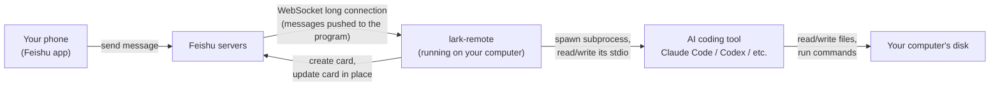
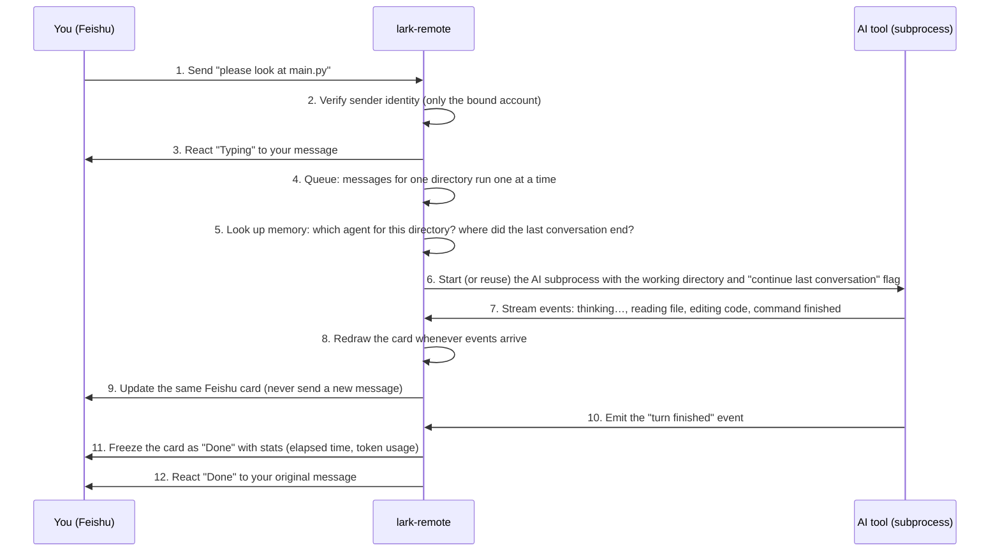
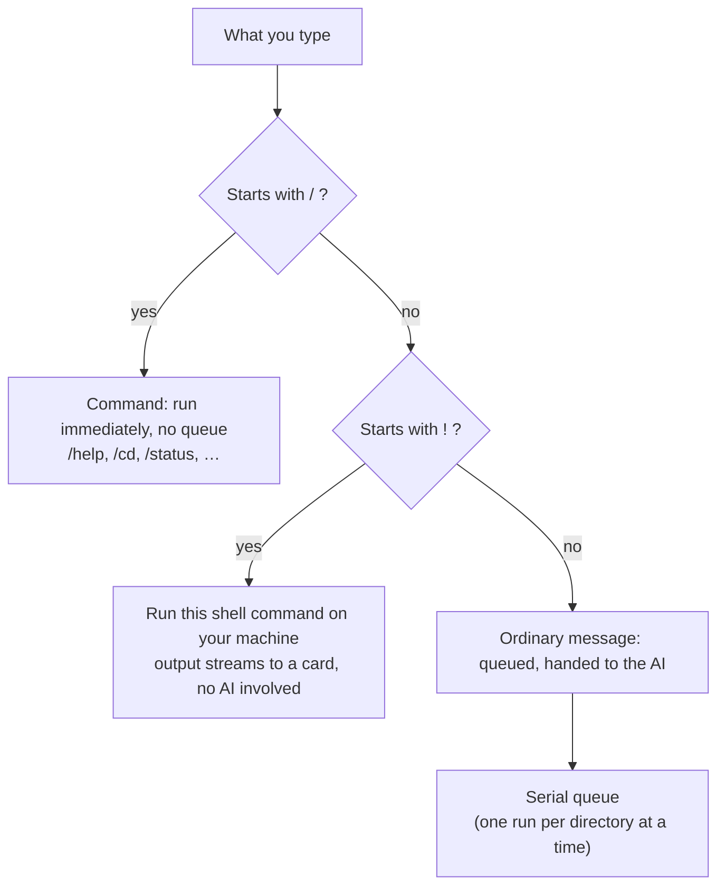
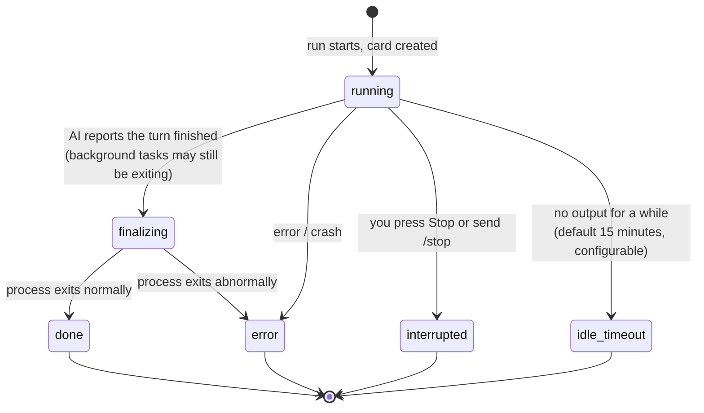
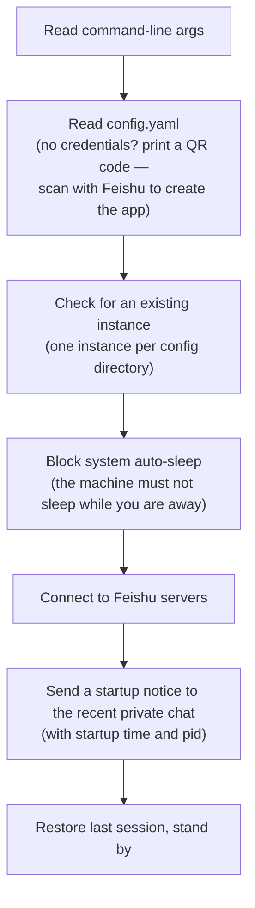

[简体中文](../../zh/architecture/how-it-works.md) | English

# How It Works: The Journey of a Message

This document answers three questions: what does lark-remote do, what is it made of, and what happens inside the program after you send a message in Feishu? You do not need to write code to follow it — you only need to follow statements of the form "program A passes data to program B".

If you can already use lark-remote and want to understand its structure, start here; if you want to modify the code, continue to [design.md](design.md) and [streaming-card.md](streaming-card.md).

---

## 1. One Sentence

**lark-remote is a small program running on your computer that forwards Feishu private-chat messages to a local AI coding tool (Claude Code and friends), and draws the tool's working progress onto a single Feishu card in real time.**

It does no AI computation itself and never modifies the AI tool's configuration. It does exactly three things:

1. Carry messages from Feishu to the AI tool;
2. Carry the tool's output back to Feishu;
3. In between, manage the chores: directory switching, conversation history, approval prompts.

---

## 2. Three Actors

The whole system has three actors:

- **Feishu servers**: deliver your messages to lark-remote and deliver card renderings back to your phone. On startup lark-remote opens a WebSocket long connection (a network channel that stays open), so your computer needs no public address.
- **lark-remote**: this program. One long-running Node.js process.
- **AI coding tool**: any of Claude Code, Codex, opencode, Pi, Kimi, DSH, CodeBuddy, Qoder, started as a subprocess — lark-remote launches it for you and collects its output.

It serves exactly one user. Binding is automatic at first use: the first message you send to the app in a Feishu private chat (any content) claims the binding, and the terminal prints the same guidance at startup. After that, every message is checked against the bound Feishu account, and anyone else's messages are dropped — this program can read every file on your computer.

---

## 3. The Journey of an Ordinary Message

You send "please look at main.py". Here is the full path from sending to reply:

Step by step:

### Steps 1–3: Receiving and Checking

Feishu pushes the message to lark-remote, which does two small things first:

- **Identity check**: the sender's Feishu ID must equal the ID recorded at first binding. Messages from anyone else are dropped — this program can read every file on your computer.
- **React "Typing"**: so you know the message arrived.

### Step 4: Queuing

Messages for the same working directory are **queued**: one finishes before the next starts. Reason: the AI tool should work on only one task per directory at a time; two concurrent AI processes would interfere and replies would arrive out of order.

Queues are per directory: while a task runs in directory A, you can switch to directory B and message it without waiting.

### Steps 5–6: Restore Context, Launch the AI

In memory lark-remote keeps three facts per working directory: which agent to use (default Claude), the id of the last conversation (session id), and the directory path.

When a message arrives it turns these into launch parameters — for Claude Code, starting `claude` in the directory with `--resume <last session id>`, so the AI continues where it left off instead of starting with no memory.

- Directory unchanged, conversation not cleared → continue the last conversation (`--resume`);
- You ran `/cd` or `/new` → no resume flag, a brand-new conversation starts;
- The AI is still working on a previous message → the new message queues and waits.

### Steps 7–9: Events Become a Card

The AI tool outputs "one JSON event per line": started thinking, about to read a file, file contents, about to edit code, command finished… While reading these events lark-remote does three things:

1. **Normalize**: translate every vendor's event vocabulary into one internal set (thinking, text, tool use, tool result, done);
2. **Track state**: thinking now? running a command? errored?
3. **Redraw the card**: on every state change, regenerate the whole card and call the Feishu API to **replace the same card**.

So your phone shows one continuously updated card, never a flood of messages.

### Steps 10–12: Finishing

When the AI emits "turn finished", lark-remote freezes the card: the header becomes "✅ Done", with elapsed time and token usage, the "Stop" button is removed, and a "Done" reaction is added to your original message.

If the AI requests a risky action (editing files, running commands), the card first shows "Allow / Deny" buttons; the AI continues only after you choose — that is the approval flow.

---

## 4. Three Kinds of Input, Three Paths

What you type falls into three categories with completely different paths:

- **`/` commands** are instructions for lark-remote itself (switch directory, check status, stop a task); they never wake the AI and run immediately.
- **`!` commands** let you run a terminal command remotely (e.g. `!npm test`); output streams to a card, again without the AI.
- **Plain text** is input for the AI.

Why distinguish? A command like `/stop` would be useless if it had to queue behind a stuck task. So "control" commands take the fast lane, and "work" messages take the queue.

---

## 5. Life of a Card

Each message produces exactly one card in Feishu. Its states form a one-way road:

Two key points:

- **Cards have a size cap**. Feishu limits a card to roughly 28KB, so a card is a lossy progress summary: old thinking is pushed out of a rolling window. The AI's **final answer** is always kept in full; when even that cannot fit, the program writes the full answer into a Markdown file, sends the file, and leaves a one-line notice on the card.
- **Updates are throttled**. The AI may emit dozens of events per second; the program batches card updates to avoid Feishu rate limits.

Details in [streaming-card.md](streaming-card.md).

---

## 6. What Is Remembered, and Where

Memory has two layers:

| Layer | Where | Contents | After restart |
| --- | --- | --- | --- |
| Memory | inside the process | running tasks, queued messages | lost |
| Disk | `~/.lark-remote/` | config (`config.yaml`), last session id (`last-session.json`), directory aliases (`workspace.json`), saved prompts (`orders.json`), logs (`logs/`) | kept |

So after restarting lark-remote you do not need to `/cd` again — just send a message and the conversation continues.

---

## 7. What Happens at Startup

Three notes:

- **Single instance**: one config directory allows exactly one lark-remote; a duplicate launch is rejected. To run a second one (e.g. for another Feishu app), use `/clone` or `--config-dir` with a new directory.
- **Sleep blocking**: the typical use case is being away from the computer — if the system auto-sleeps, the Feishu connection drops. While running, the program blocks system sleep and releases the block on exit.
- **Orphan cleanup**: if the previous lark-remote exited abnormally, the AI subprocesses it started become orphans (still running, nobody watching them). Cleanup is not a global startup scan — before a directory uses an AI for the first time in this run, lark-remote checks that directory for leftover processes and stops them before starting a new one. lark-remote also stops all AI subprocesses it started when it exits (including Ctrl+C).

---

## 8. A Tour of the Code Directories

One sentence per directory:

| Directory | What it does |
| --- | --- |
| `src/connector/` | All network I/O with Feishu: receive messages, send/update cards, upload files |
| `src/message-handlers.ts` | Message entry: identity check, split the three input kinds |
| `src/router/` | Implementations of `/` commands and card-button callbacks |
| `src/bridge/` | Queuing, starting runs, approval coordination, stop control |
| `src/runner/` | Adapter layer for the 8 AI tools, one subdirectory per agent |
| `src/session/` | Read each tool's on-disk conversation files (for `/resume`) |
| `src/card/` | Render internal state into Feishu card JSON under a size budget |
| `src/inbound/` | Images/files you send: download to disk, inject paths into the AI's prompt |
| `src/config/` | Config file I/O and the first-launch QR wizard |
| `src/platform/` | Cross-platform differences (macOS / Linux / Windows process control) |
| `src/index.ts` | Entry point: assemble all components in order |

---

## 9. Going Deeper

| Topic | Document |
| --- | --- |
| Install and run it | [getting-started.md](../getting-started.md) |
| All commands in detail | [../usage.md](../usage.md) |
| Module-level design and known pitfalls | [design.md](design.md) |
| Streaming card mechanics | [streaming-card.md](streaming-card.md) |
| Token usage semantics | [token-usage-scope.md](token-usage-scope.md) |
