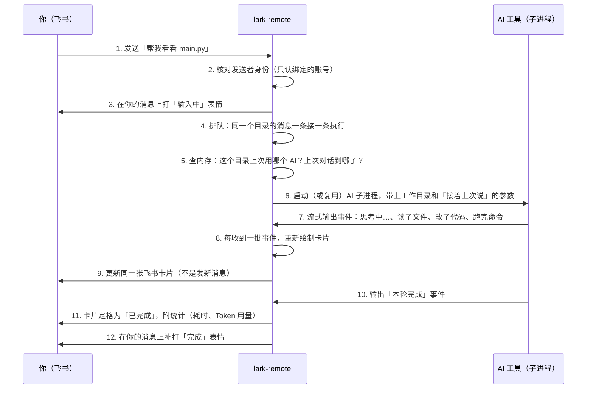
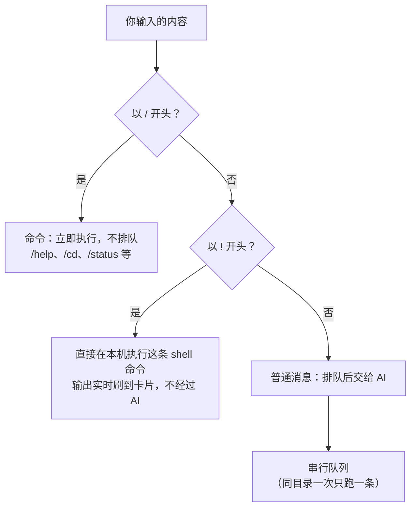
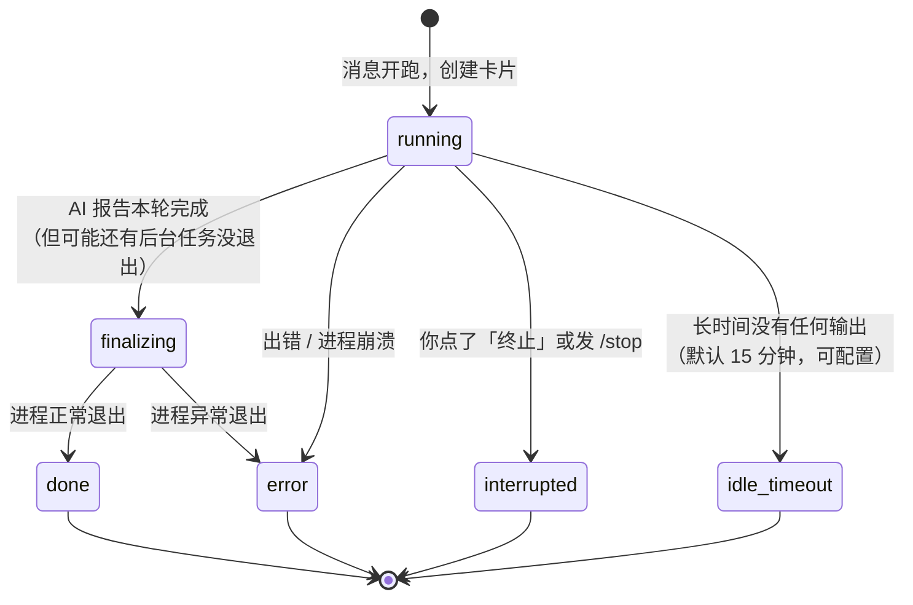
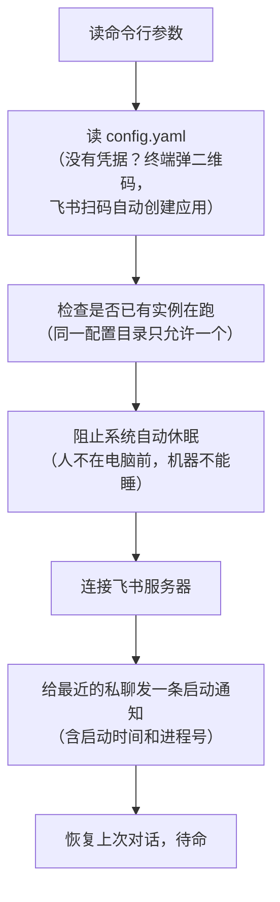

[English](../../en/architecture/how-it-works.md) | 简体中文

# 运行原理：一条消息的旅程

这份文档回答三个问题：lark-remote 是干什么的？它由哪几部分组成？你在飞书里发一条消息之后，程序内部发生了什么？读完后你不需要会写代码，只需要知道「程序 A 把数据传给程序 B」这种因果关系。

已经会用 lark-remote、想了解内部结构的读者，从本文开始；要改代码的读者，再看 [design.md](design.md) 与 [streaming-card.md](streaming-card.md)。

---

## 1. 一句话说明

**lark-remote 是一个跑在你电脑上的小程序，它把飞书私聊里的消息转发给本机的 AI 编程工具（Claude Code 等），再把 AI 的工作过程实时画到飞书的一张卡片上。**

它自己不做任何 AI 计算，也不修改 AI 工具的任何配置。它只做三件事：

1. 把飞书消息搬给 AI 工具；
2. 把 AI 工具的输出搬回飞书；
3. 中间帮你管好目录切换、历史对话、审批确认这些杂事。

---

## 2. 三个角色

整个系统只有三个角色：

- **飞书服务器**：负责把你的消息送到 lark-remote，再把卡片画面送到你手机上。lark-remote 启动时会和飞书服务器建立一条 WebSocket 长连接（一条不断开的网络通道），所以你的电脑不需要公网地址。
- **lark-remote**：本程序。一个 Node.js 进程，常驻运行。
- **AI 编程工具**：Claude Code、Codex、opencode、Pi、Kimi、DSH、CodeBuddy、Qoder 中的任意一个，以「子进程」方式被 lark-remote 启动——也就是 lark-remote 替你在终端里把它跑起来，接住它的输出。

只服务一个用户。首次使用时绑定自动完成：你在飞书里私聊本应用发出的第一条消息（任意内容）就完成认领，启动时终端也会打印这段指引；此后每条消息都会核对发送者是不是绑定的那个飞书账号，不是则直接忽略——因为这个程序能读你电脑上的所有文件。

---

## 3. 一条普通消息的旅程

你在飞书里发一句「帮我看看 main.py」。下面是这句话从发出到回复的完整过程：

下面逐步展开。

### 第 1–3 步：接收与核验

飞书服务器把消息推给 lark-remote。程序先做两件小事：

- **身份核验**：消息发送者的飞书 ID 必须等于首次绑定时的 ID。别人的消息一律丢弃——因为这个程序能读你电脑上的所有文件。
- **打「输入中」表情**：让你知道消息已被收到。

### 第 4 步：排队

同一个工作目录的消息会**排队**，一条执行完才执行下一条。原因：AI 工具一次只应该在一个目录里干一个活，两条消息同时开两个 AI 进程会互相干扰、回复顺序也会乱。

排队以「工作目录」为单位：目录 A 里在跑任务时，你切到目录 B 发消息，两边互不等待。

### 第 5–6 步：恢复上下文，启动 AI

lark-remote 在内存里记住每个工作目录的三个信息：用哪个 AI（默认 Claude）、上次对话的编号（session id）、工作目录路径。

发消息时它把这些拼成启动参数：比如对 Claude Code 来说，就是带上 `--resume <上次对话编号>` 在指定目录下启动 `claude` 进程。这样 AI 能「接着上次聊」，而不是每次都失忆重来。

- 目录没变、对话没清 → 接着上次的对话继续（`--resume`）；
- 你执行过 `/cd` 或 `/new` → 不带 resume 参数，开一场全新对话；
- AI 进程还在跑上一条消息 → 新消息排队等它结束。

### 第 7–9 步：事件流变成卡片

AI 工具以「一行一个 JSON 事件」的格式持续输出：开始思考了、要读某个文件了、读到了什么、要改代码了、命令跑完了……lark-remote 一边读这些事件，一边做三件事：

1. **归并**：把不同格式的各家 AI 事件，统一翻译成 lark-remote 自己的一套事件（思考、正文、用工具、工具结果、完成）；
2. **维护状态**：当前在思考？在跑命令？出错了吗？
3. **重绘卡片**：每次状态变化，重新生成整张卡片的内容，然后调用飞书接口**替换同一张卡片**。

所以你手机上看到的始终是一张不断变化的卡片，而不是刷屏的一串消息。

### 第 10–12 步：收尾

AI 输出「本轮完成」事件后，lark-remote 把卡片定格：标题变成「✅ 已完成」，附上耗时和 Token 用量统计，移除「终止」按钮，并在你原来那条消息上补打一个「完成」表情。

如果过程中 AI 要求执行有风险的操作（改文件、跑命令），卡片会先弹出「允许 / 拒绝」按钮，你点了之后 AI 才继续——这就是审批。

---

## 4. 三种消息，三条路

你在聊天框里输入的东西分三类，走完全不同的路：

- **`/` 命令**是给 lark-remote 本身的指令（切目录、看状态、停任务），不惊动 AI，立即执行；
- **`!` 命令**是让你远程跑一条终端命令（比如 `!npm test`），输出刷到卡片上，也不惊动 AI；
- **普通文字**才是给 AI 的输入。

为什么要区分？因为 `/stop` 这类命令如果也要排队，就会排在正在卡死的任务后面，永远执行不到。所以「控制类」命令走快速通道，「工作类」消息走队列。

---

## 5. 卡片的一生

每执行一条消息，飞书里只出现一张卡片。它的状态变化是一条单行道：

两个关键点：

- **卡片内容有上限**。飞书对单张卡片有约 28KB 的大小限制，所以卡片是一份「有损的过程摘要」：旧的思考内容会被滚动窗口挤掉。AI 的**最终回答**永远完整保留；实在放不下时，程序会把完整回答写成一个 Markdown 文件发给你，卡片里只留一句提示。
- **卡片更新由程序节流**。AI 每秒可能输出几十条事件，程序把更新攒起来按节奏刷，避免触发飞书限流。

细节见 [streaming-card.md](streaming-card.md)。

---

## 6. 记住了什么、存在哪

lark-remote 的记忆分两层：

| 层 | 存哪 | 存什么 | 断电（重启）后 |
| --- | --- | --- | --- |
| 内存 | 进程内部 | 正在跑的任务、排队中的消息 | 丢失 |
| 磁盘 | `~/.lark-remote/` 目录 | 配置（`config.yaml`）、上次对话编号（`last-session.json`）、目录别名（`workspace.json`）、常用指令（`orders.json`）、日志（`logs/`） | 保留 |

所以重启 lark-remote 后，你不需要重新 `/cd`，直接发消息就能接着上次的对话聊。

---

## 7. 启动时发生了什么

三点说明：

- **单实例**：同一份配置目录只允许跑一个 lark-remote，重复启动会被拒绝。想跑第二个（比如给另一个飞书应用），用 `/clone` 或 `--config-dir` 指定新目录。
- **防休眠**：这个工具的典型用法是人不在电脑前，系统一旦自动休眠，飞书连接就断了。所以程序运行期间会阻止系统休眠，退出后自动解除。
- **残留进程清理**：如果上一次 lark-remote 异常退出，它启动过的 AI 子进程会变成「孤儿」（还在跑但没人管）。清理不是在启动时全局扫一遍，而是在**某个目录第一次要用某个 AI 干活之前**，检查该目录下有没有上次残留的进程，有就先停掉再开新的。另外 lark-remote 自己退出时（包括 Ctrl+C）也会顺手停掉它启动的所有 AI 子进程。

---

## 8. 代码目录导览

每个目录一句话：

| 目录 | 干什么 |
| --- | --- |
| `src/connector/` | 和飞书的所有网络通信：收消息、发卡片、更新卡片、传文件 |
| `src/message-handlers.ts` | 消息入口：核验身份、给三类消息分流 |
| `src/router/` | `/` 命令的具体实现和卡片按钮点击的处理 |
| `src/bridge/` | 排队、启动每次运行、审批协调、停止控制 |
| `src/runner/` | 对接 8 种 AI 工具的适配层，每家一个子目录 |
| `src/session/` | 读取各 AI 工具落盘的历史对话文件（供 `/resume` 展示） |
| `src/card/` | 把内部状态画成飞书卡片 JSON，控制大小预算 |
| `src/inbound/` | 你发来的图片/文件：下载落盘、把路径写进给 AI 的话里 |
| `src/config/` | 配置文件的读写、首次启动的扫码向导 |
| `src/platform/` | 跨平台差异（macOS / Linux / Windows 的进程启停方式） |
| `src/index.ts` | 程序入口：按顺序把上面所有部件组装起来 |

---

## 9. 想再深入

| 想了解 | 看哪里 |
| --- | --- |
| 装起来跑一遍 | [getting-started.md](../getting-started.md) |
| 所有命令的用法 | [../usage.md](../usage.md) |
| 每个模块的设计细节与历史坑点 | [design.md](design.md) |
| 卡片流式更新的机制 | [streaming-card.md](streaming-card.md) |
| Token 用量统计的口径 | [token-usage-scope.md](token-usage-scope.md) |
